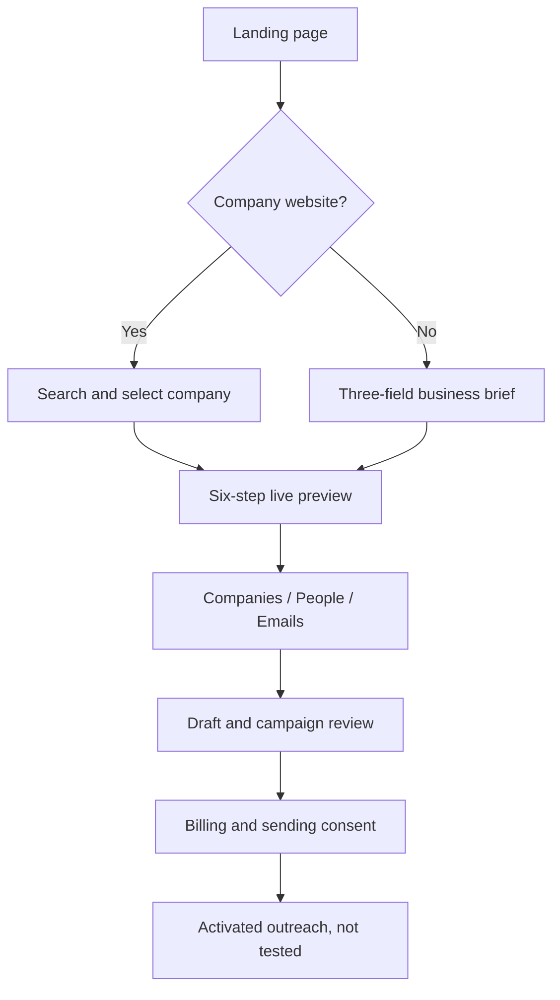

# 01 | Observed user journey

This is an evidence-led description of the unauthenticated Explee experience with Jedar on 2026-11-09. Screen labels are recorded where needed for interaction fidelity. Product claims are not independently validated performance results.

## Journey at a glance

## Screen L01. Landing page

- Full-width header: logo, Products dropdown, Pricing anchor, Affiliates link, Sign in
- Centralized hero: recent aggregate counter and median cost per lead, headline, two reassurance chips, domain input, launch CTA, alternate link for visitors without a website
- Input uses a changing example placeholder and an accessible label; desktop CTA shows an arrow with `Launch`, mobile shows `Find my leads`
- CTA is disabled when no valid input has been entered
- Under hero: brief automated pipeline summary, testimonial cards, ticker-like reviews, six stage demonstrations, three differentiator claims, compact pricing calculator, eight FAQ accordions, final CTA and footer
- Products menu on mobile contained API, Database, Google Maps Dataset and Explorer links; the API destination points to a public docs site
- Landing claims included 1 to 3 hot leads within 24 hours, $30 initial credits, no SDR/email setup, $9 median cost per hot lead, 105M+ companies, 80M+ decision makers, and 97% inbox rate. These are product claims, not validation findings

**Observed interactions**

| Trigger | State transition | Result |
|---|---|---|
| Typing `https://jedar-agency.com/` | `empty -> input -> suggestion` | URL normalized to `jedar-agency.com`, one recognized company suggestion appeared |
| Selecting suggestion | `suggestion -> company route` | Navigated to `/auto-gtm/company/jedar-agency.com/explore` |
| Clicking `I don't have a website` | `landing -> modal` | Three required brief fields and disabled submit until completed |
| Clicking FAQ row | `closed -> expanded` | Inline answer appears, other row can collapse |
| Clicking Sign in | `landing -> auth` | External auth host with work-email flow and LinkedIn option |
| Clicking mobile Menu | `closed -> expanded nav` | Products, Pricing, Affiliates, Sign in |

### Autocomplete payload

The browser requested `GET /api/companies/search?q=jedar-agency.com` and received a JSON array with `name`, `domain`, `desc`, `explee_id`. The description said Jedar focused on Saudi crisis and reputation management, and the suggestion included a favicon and one-line summary

The click on the suggestion was the decisive transition in this session. The arrow CTA did not have to be clicked afterward

## Screen L02. No-website alternative

The modal asked three questions in order

1. What do you sell or want to build
2. Who is your ideal customer
3. Which markets or geography

There is a Generate my campaigns CTA, Close control, business examples in placeholders, and focus on the first textarea on open. We inspected the form without submitting a second project

**Replica behavior:** permit both domain-led and brief-led project creation. Treat each as a different input provenance and allow completion without a company URL

## Screen A01. Research your company

The first phase appeared as a centered, progressive card with step number, found-company card, description, `Details look off?`, metadata chips and keywords

Jedar values displayed in the UI

- Name: `جدار | JEDAR`
- Domain: `jedar-agency.com`
- Founding year: `2024` as supplied by Explee
- Size: `6 emp` as supplied by Explee
- Country: Saudi Arabia
- Keywords: crisis management, media reputation, digital presence, emergency response, corporate communication, social media monitoring, AI analytics, real-time tracking

The `Details look off?` control expanded an inline note explaining that the preview relies on public data and company and country details can be corrected in the account before sending. It did not offer direct inline editing to an anonymous visitor

Behind this phase, `GET /api/project/jedar-agency.com` returned one project representation containing company metadata, parsed determinants, competitor domains, search queries, target segments, run status, proposed sender domains, keywords and a pipeline event history

**Important cached-state limit:** the project existed before our active browser run. The agent ensure response later returned `created: false` and `status: done`

## Screen A02. Explore competitors

The preview listed 12 domains in a compact two-column grid within the step sidebar, with a `+4 more` affordance beyond eight visible links. Examples included `askolly.io`, `reptt.nl`, `wizikey.com`, `reputation.com` and `getdandyreviews.com`

Observed elements

- Competitor count badge
- Small external domain cards
- Favicon/domain presentation
- Link opening the competitor site in a separate browser target
- Collapsible step heading and a small adjacent icon button

No real competitor verification, competitive positioning matrix, or editable exclusion list was tested without an account

## Screen A03. Define campaigns

Six recommended target segments appeared as clickable cards. Click on the first card opened a focused detail overlay containing use case, pain, positive criteria, estimated companies and recognizable client examples

| Segment | Estimated companies supplied by Explee | Buyer type | Geography |
|---|---:|---|---|
| Founder-led SMBs | 1,200 | Company | Saudi Arabia |
| Founders | 5,000 | Individual | Saudi Arabia |
| Retail chains | 2,400 | Company | Saudi Arabia |
| Telecom brands | 120 | Company | Saudi Arabia |
| Hospital groups | 500 | Company | Saudi Arabia |
| Hospitality operators | 1,500 | Company | Saudi Arabia |

For the first segment, the card detail explained the pain of lean teams facing reputation attacks, and included qualifying criteria such as public-facing founder, lean marketing team, and direct customer relationships. The API representation also held negative criteria, keywords, target geography, decision maker description and sample clients

These counts are estimates in the preview, not verified total addressable market measurements. The same brand can fit multiple segments, and the categories are overlapping

## Screen A04. Find potential customers

During loading, a compact status log simulated or reflected work units such as query construction, index retrieval, fit scoring and ranking. The main surface then became a table with columns

`Company | Description | Location | Size | Monthly traffic`

The observed first-segment dataset contained seven rows

| Company | Domain | Country | Employees in response | Monthly traffic in response |
|---|---|---|---:|---:|
| Olive | olive.sa | SA | 100 | absent |
| NAJM ALGHTHA | najm-alghtha.com | SA | 60 | 309 |
| Al Fahim | alfahimhq.com | AE | 20 | 4,570 |
| Saud Yangtze | ksacj.com | SA | 16 | absent |
| Nama Arabia | missing domain | SA | 100 | absent |
| Sana | sanagroups.in | IN | 2 | absent |
| Dawwat | dawwat.com | GB | 1 | absent |

Location, Size and Monthly traffic have clickable sort-looking headers; exact sort behavior and persistence were not established. Some rows showed up/down traffic change marks. Tables provide external domain links where available, otherwise a letter avatar

**Quality observation:** despite the segment's target geography being Saudi Arabia, the returned seven-row set included AE, IN and GB. A replica should clearly expose the origin of each match, and enforce geography on final qualification rather than silently presenting all as Saudi matches

The browser observed `POST /api/agent/ensure/{segment_id}` followed by reads of `_companies.parquet` through a JSON wrapper providing `columns`, `rows`, `total_rows`, `offset`, `limit`. It also observed a stream endpoint. These are browser-facing names and shapes, not a recommended external API for our product

## Screen A05. Find decision makers

Columns: `Name | Job Title | Company | Geo`. The observed dataset contained

- Saleh Alrshoodi, CEO and founding partner, `najm-alghtha.com`, LinkedIn URL present
- Mohamed Al Fahim, Founder, `alfahimhq.com`, profile URL absent

One profile linked out to LinkedIn; geography cells were empty despite company country data. Names, job roles and company references came from a data API, with no observed verification badge

## Screen A06. Write emails

The step exposed vendor labels `hunter`, `exreacher`, `findymail`, `leadmagic` on each person's enrichment row. Both displayed `no email found`, while a personalized draft was still shown below

The draft preview contained

- recipient card with person's name, title, organization and LinkedIn link
- `To` row with a person's name
- `Subj` inline editable text input
- resizable-looking, auto-height body textarea with click-to-edit hint
- settings gear, showing a popup with Tone slider from Formal to Casual and Calendar link toggle
- settings appeared locked/disabled during anonymous preview
- CTA to claim credits and send, which opens billing rather than immediately delivering an email

The inspected `POST /api/draft/generate` request supplied `segment_id`, `person_profile_url`, `company_domain`, first/last name, title, company name and description. The response included a draft subject, body, `language_used: English`, `language_reason` and an empty `draft_id`. No model name was present

The backend selected English for this Saudi-targeted outreach because of recipient company context. The language choice was justified in the response, but the UI did not surface the reason or offer an obvious language selector in the public preview

## Screen A07. Final preview

The six-step sequence became a persistent app layout

- Left panel: collapsible completed steps, company card, competitors, campaign cards
- Top/center: numbered progress rail, current-state banner, primary activation CTA
- Results switcher: `Companies`, `People`, `Emails`
- Main panel: chosen result table or draft editor
- After activation preview: three future steps Send emails, Book meetings, Learn & double down

The final phase can be revisited via its URL query `phase=final`. We did not establish whether that direct route is always replayable in a new browser or session

## Screen P01. Billing and authorization handoff

The modal opened from the Start outreach CTA and also appeared automatically in the final-state capture during this run. It uses a payment plan selector, testimonial proof, email input, Stripe card element, required consent checkbox and disabled submit until validity requirements are met

Two alternatives observed

1. Upfront top-up: pay $30 to receive $60 credits, with $50/$100 alternatives. The UI associates these with approximate sending and reply forecasts and a conditional refund promise
2. Pay as you go: no charge today, then $0.04 per sent email, yet a valid card is required. Submit label changes to Add card and start

The checkbox text authorizes Explee to send on behalf of Jedar and accepts Terms. Payment submission, actual consent recording, sender activation and future billing were deliberately **not** tested

The pricing FAQ says the $30 complimentary credit is granted when billing is set up, while the modal defaults to a paid top-up. This should be written as a conversion clarity issue rather than assumed fraud or a broken promotion

## Auth boundary

The Sign in link navigated to a separate `auth.explee.com` host with Logto attribution. Both sign-in and create-account pages displayed a work-email input and Continue with LinkedIn, with no-account and existing-account alternate links

No authentication, email verification, or authorized dashboard was examined

## Mobile observations

- On 390px width, landing navigation collapses to a Menu button
- Website input and `Find my leads` CTA stack vertically
- Testimonial cards and sections become a long single-column scroll
- The final experience changed to a six-step vertical accordion with a fixed bottom `Start outreach with $30 free` action
- The paywall occupied a vertically scrolling mobile surface, and Stripe elements stayed below the fold
- No whole-page horizontal overflow was measured at the body level; one illustrative marketing table appeared wider than its container and may be visually clipped

## What happened after the preview

Nothing was sent. Explee presents follow-up, reply handling, appointment booking and learning as capabilities in marketing and post-activation headings. Their exact authenticated workflows, schedules, limits, analytics and error recovery remain outside observed coverage
