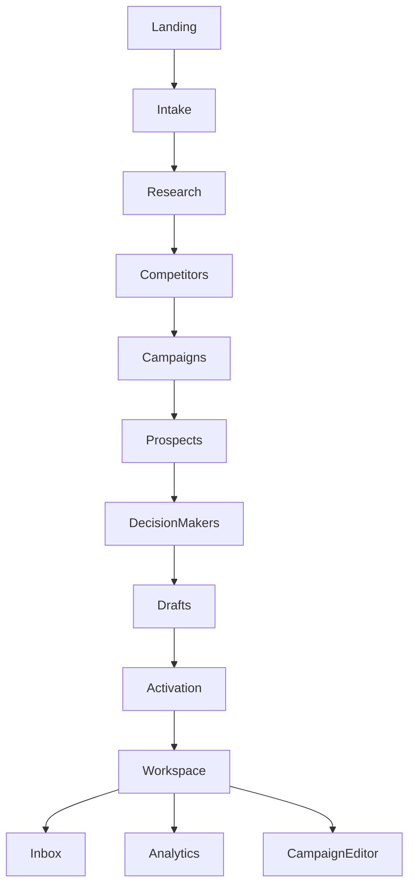

# 02 | UI, UX and conversion experience specification

The target is a functionally comparable, independently designed product. The values below distinguish observed Explee behavior from proposed interaction rules. Do not reuse Explee branding, graphics, customer names, or protected copy

## Product experience principle

Give an anonymous visitor a useful sample before asking for account setup. Let the user understand exactly whom the software would target, why, and what its first message could look like. The product's persistent workspace takes over once a campaign is activated

## Information architecture

## Screen inventory

| Screen ID | Screen | Entry | Primary job | Exit |
|---|---|---|---|---|
| L01 | Landing | Direct visit | Establish offer and capture domain | Domain selection or manual brief |
| L02 | No-website intake | Landing alternate CTA | Capture product, ICP, geo | Generate preview |
| A01 | Research | Domain resolved | Display company understanding | Next stage |
| A02 | Competitors | Company researched | Show market reference set | Next stage |
| A03 | Segments | Competitors known | Explain and select buyers | Prospect discovery |
| A04 | Companies | Segment selected | Surface ranked accounts | People view |
| A05 | People | Companies qualified | Surface decision makers | Draft view |
| A06 | Emails | Person selected | Review and edit message | Activation |
| P01 | Payment/consent | Outreach CTA | Choose spend mode and authorize sending | Account/checkout |
| AU01 | Auth | Sign in/register | Establish identity | Workspace |
| W01 | Workspace | Authenticated, activated | Control campaigns and monitor outcomes | Inbox, leads, analytics |

Screens L01 to P01 were observed. W01 and its children are proposed based on publicly stated capabilities and should not be described as copied views

## Desktop composition

**Landing:** centered hero, very large h1 with short line breaks, input plus inline icon CTA, small counter badges above, social proof below, ordered capabilities section, compact pricing and accordion FAQ. Header is sticky-looking but stickiness was not formally tested

**Auto-GTM preview:** desktop uses a roughly 300px left rail and a flexible right work area. The left side contains progress and collapsible company context, competitor domain tiles, target-segment cards. The right side has a top activation band, progress rail, tabbed results and a table or editor. Both sides can maintain scroll positions

**Result tabs:** Companies, People, Emails. Switching tabs replaces the main work surface and retains company and campaign context. This is one continuous screen rather than separate pages per table

**Draft:** narrow list of enrichment candidates beside an email composer; send action stays visible near the composer. Settings gear opens a small popover above the button

**Payment:** light checkout panel/sheet with plan radios, social proof, email, card widget and consent. Submission remains disabled until required fields and authorization are complete

## Mobile composition

Observed viewport: 390 x 844 CSS pixels

- Landing header contains logo and hamburger menu; expanded menu reveals a vertical list and a Products submenu
- Hero form stacks the input above a full-width `Find my leads` button
- Marketing sections stack into one column and social proof becomes horizontal slides or a lengthy vertical sequence
- Auto-GTM shows the six phases as collapsible vertical accordions with a bottom fixed activation bar
- Payment content scrolls vertically; do not rely on the whole desktop modal being visible at once
- A marketing demonstration table extended beyond the content width. Our implementation must allow intentional horizontal table scrolling with an explicit visual cue, not silent clipping

### Proposed responsive breakpoints

| Width | Layout |
|---|---|
| under 640px | Single-column, accordion, bottom safe-area CTA, tab scrolling |
| 640px to 1023px | Two-column only if enough room; otherwise accordion |
| 1024px and above | 280 to 320px side rail, main pane fluid |

Support 320, 360, 390, 430, 768, 1024, 1280 and 1440px regression snapshots

## Visual language benchmark

Explee's current rendered Auto-GTM theme was predominantly near-white with black text, soft gray dividers and an emerald action color. The browser exposed these public CSS values

| Item | Observed CSS value | Replica direction |
|---|---|---|
| Action green | `#059669` | Choose a distinct brand color, retain comparable contrast |
| Brand mid green | `#10b981` | May inform semantic success tone only |
| Danger red | `#ff5956` | Separate destructive and error semantics |
| Warning orange | `#ff8e00` | Use for blockers and queued tasks |
| Canvas | near `lab(97.68% 0 0)` | Quiet low-contrast surface |
| Card | white | Clear boundary and shadow only when useful |
| Text | near black | Strong primary reading contrast |
| Muted text | `lab(53.6% 0 0)` | Use accessible secondary contrast |
| Divider | black at about 8% alpha | Thin border with meaningful grouping |
| Typography | Geist Sans main, DM Sans in some payment/editor elements | Select an independent readable family with Arabic support |

The exact palette is provided for investigation, not as a requirement to reproduce the competitor's trade dress

## Component inventory

| Component | Inputs and visible parts | Behavior |
|---|---|---|
| `CompanySearch` | URL textbox, suggestion list, favicon, description | Debounce, normalize, keyboard navigation, selection, escape |
| `ManualBusinessBrief` | Product, buyer, geography fields | Validation, modal close/focus return, submit loading |
| `PhaseStepper` | Number, name, status, completion icon | Current phase highlight, replay completed stages, accessible state |
| `CompanyIdentityCard` | Name, domain, logo, description, year, size, country | Expand details; edit after authentication |
| `CompetitorGrid` | Count, domain tile, show-more | External opens safely, edit/exclude in workspace |
| `SegmentCard` | Title, icon, size estimate | Click to open details, select campaign |
| `SegmentDetail` | Use case, pain, criteria, exclusions, sample clients | Close, review data, add adjustments in account |
| `ProgressLog` | Completed and active microsteps | Animate to real progress; preserve logs for retry |
| `CompanyTable` | Name, description, country, size, traffic | Sort, filter, link, pagination, empty state |
| `PeopleTable` | Person, role, company, geo, profile | Sort, link, data confidence and contact state |
| `EmailWaterfall` | Contact, provider attempts, verification outcome | Distinguish unknown, not found, queued, found and verified |
| `EmailComposer` | Recipient, subject, body, tone, link, CTA | Autosize, draft persistence, edit, regenerate with rationale |
| `PaymentChoice` | Prepaid tiers, pay-as-you-go radio | Recompute totals, show exact due-now and billing rules |
| `AuthorizationGate` | Work email, payment, consent | Explain scope, disable submit until validated |
| `SupportWidget` | Floating help trigger | Never overlap primary CTA on mobile |

## Canonical interaction states

`idle`, `typing`, `suggestions_loading`, `suggestions_ready`, `no_match`, `invalid_domain`, `company_found`, `research_loading`, `research_ready`, `research_failed`, `segments_loading`, `segments_ready`, `agent_queued`, `agent_running`, `agent_partial`, `agent_done`, `agent_failed`, `draft_loading`, `draft_ready`, `draft_editing`, `activation_open`, `activation_validating`, `payment_pending`, `activated`

Every async stage must have

- An actual server-backed status, not a decorative progress percentage that implies completion
- A compact status line and optional expanded log
- Retry for transient failures
- Partial results displayed with a visible completeness label
- A safe resume path on refresh, new tab and browser restart
- Non-destructive navigation across completed steps

## Form and error details

### Website input

- Accept bare domain and absolute `http`/`https` URL, normalize hostname and remove irrelevant path/query
- Reject unsupported schemes, local/private addresses, malformed URLs and overlong input server-side
- Debounce search with cancellation of stale responses
- Provide both recognized-entity selection and manual `Analyze this website` fallback when search has no match
- Display reasons for unreachable domains or incomplete public data
- Support Internationalized Domain Names and Unicode display, while storing canonical punycode hostname
- Enter key triggers highlighted suggestion or direct analyze, never an accidental paid action

### Campaign and leads

- Counts must label `estimated` versus `verified` and explain overlap
- Empty contact or null traffic values use a consistent placeholder
- Missing domain and location must not be presented as fact
- Users can exclude competitors and update ICP before activation
- Contact enrichment result must be separate from draft generation result
- Sorting announces current ascending/descending state and persists within the view

### Email editor

- Autosave subject/body to project-scoped draft with timestamp and visible saved state
- Preserve user's edits on tab change and refresh
- Allow regenerate variants without overwriting edited text silently
- Display sender identity, recipient verified email status, chosen language and reason
- The send button must remain disabled while verified email is absent or consent is missing, with a clear explanation
- Include link to edit target language, tone and calendar destination

## RTL and Arabic requirements

- Arabic navigation, labels and main structure use `dir=rtl`
- Email bodies default to their detected language direction independently of application chrome
- Domains, URLs, emails, phone numbers, timestamps and currency amounts remain LTR islands
- Column order reverses deliberately for RTL while sorting and keyboard order remain logical
- Search suggestions combining Arabic names and Latin domains must not reorder characters
- Use a font with well-formed Arabic shaping, appropriate line-height and diacritic support
- Provide localized validation and loading messages, no English-only overflow in narrow controls

## Accessibility contract

- WCAG 2.2 AA target, including minimum text contrast and visible focus
- All menus, tabs, radios, dialogs and accordions accessible by keyboard
- Correct semantic roles and `aria-expanded`, `aria-selected`, `aria-live` and dialog focus trap
- Progress updates announced politely rather than every animation tick
- Redundant icons have no accessible names; meaningful icon buttons do
- Reduced-motion preference disables ticker animations and stage transitions
- Table scroll wrappers should be focusable with clear labels on mobile
- Error summaries link to the corresponding field

## Conversion experience rules

1. The input is the only primary action above the fold
2. Show a helpful first result before requiring registration
3. Explain why a suggested segment fits this exact company
4. Show real data coverage and verified-email counts next to previews
5. Keep pricing consistent between landing FAQ, CTA and checkout
6. State the sender-domain policy and consent scope before payment
7. Give a clear estimated time to usable results and display what is cached
8. Preserve user progress through account creation and billing
9. Make the first post-activation action obvious: inspect inbox, change budget or connect calendar
10. Avoid fabricated live-looking counters or guaranteed lead quantities in our version

## Proposed UI event names

`landing_view`, `domain_input_change`, `company_suggestion_seen`, `company_selected`, `manual_brief_open`, `preview_step_start`, `preview_step_complete`, `segment_open`, `segment_selected`, `results_tab_selected`, `lead_row_open`, `draft_generated`, `draft_edited`, `draft_settings_open`, `activation_clicked`, `payment_plan_selected`, `consent_checked`, `billing_success`, `campaign_activated`

Map them to the fuller event dictionary in `06_ANALYTICS_AND_PRICING.md`
