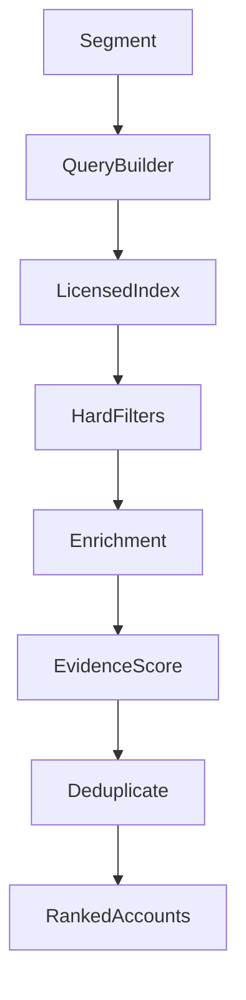
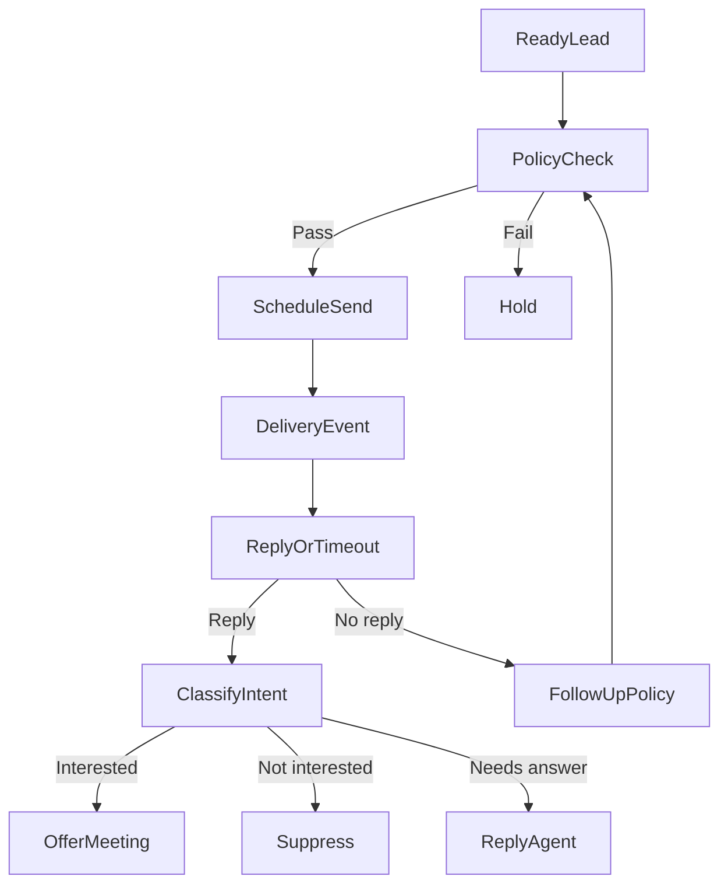

# 03 | Functional requirements for an autonomous B2B GTM product

This document defines a clean-room feature set. Sections marked **Observed** came from the browser. **Disclosed** means Explee describes the feature publicly. **Proposed** means our implementation decision, which should be validated with pilot users

## Actors and permissions

| Actor | Capabilities |
|---|---|
| Anonymous visitor | Search company, generate limited public preview, inspect segments, people and draft |
| Owner | Confirm organization, set budget/markets, activate, manage billing and campaign policies |
| Team member | View campaigns, revise briefs, respond to exceptions based on role |
| Autonomous outreach agent | Find leads, qualify, enrich, draft, schedule, send, follow up, classify replies, offer meeting slots, learn within authorization |
| Billing service | Record usage, credits, invoices, payment events and idempotent renewals |
| Compliance operator | Handle suppression and privacy requests, audit campaign conduct |

## F01. Company intake and enrichment

**Observed:** autocomplete provides recognized company by domain. Project payload returns description, profile, founder year, size, location, industry, scoring keywords and competitors

**Proposed algorithm**

1. Canonicalize and validate domain
2. Lookup a licensed organization index
3. If found, show provenance and confidence per fact
4. Crawl publicly accessible pages if permitted, with SSRF defense, robots policy, bounded fetch and anti-bot respect
5. Extract product, positioning, use cases, buying triggers, sales motion and target locations from licensed/public sources
6. Detect contradictions across sources and ask for targeted correction only when necessary
7. Save a versioned CompanyProfile with source references

**Output:** `company_profile`, `value_propositions[]`, `determinants[]`, `keywords[]`, `source_links[]`, `confidence`

**Fallback:** no valid domain, inaccessible site, ambiguous entity, sparse data, Arabic-only site, company with multiple brands, agency selling multiple services

**Acceptance:** no silent false company association; user can replace the selected entity; generation cannot mark inferred fields as verified

## F02. Competitor research

**Observed:** 12 competitor domains for Jedar and search queries in the project API

**Proposed:** generate competitor candidates using overlap of offer, customer problem, geography and alternative solutions. Add rationale and a `direct / adjacent / substitute` label. Filter irrelevant entities and duplicates; retain source and score. User can exclude or include a competitor

**Output:** `competitors[]` with URL, rationale, category, evidence, score, status

**Acceptance:** an irrelevant competitor can be removed and does not reappear in downstream prompts until manually restored

## F03. ICP and segment generation

**Observed:** six Jedar campaigns with label, pain, use case, positive and negative criteria, example accounts, estimated count, buyer type, country and decision-maker brief

**Proposed segmentation unit**

- Who pays: sector, role, company size, location, business model
- Why now: trigger events and observable signals
- Need: concrete business problem and consequences
- Buying authority: economic buyer, influencer and operator
- Exclusion: prospects unlikely to benefit or not legally contactable
- Offer: promise anchored to actual product proof
- Market size: estimated and clearly labeled with methodology

Support zero-to-many segments, merge, duplicate, edit, pause, order and hard exclusion. A campaign uses a versioned segment snapshot so changing one segment doesn't silently alter active outreach

**Acceptance:** geographic criteria and exclusions are enforced at lead-query, lead-ranking and send time

## F04. Company discovery and scoring

**Observed:** `agent/ensure` chooses or reuses a run; a stream and row endpoints expose company and people tables. Loading UI announces query building, matching, scoring and ranking

**Proposed pipeline**

Hard filters are deterministic: country, sanctioned/excluded accounts, company status, sector boundaries, blocklisted domains, do-not-contact and required fields. Score after filters using segment fit, trigger freshness, data confidence, potential value and contactability

**Rank explanation:** every top account should expose 2 to 4 observed reasons, along with unknowns and disqualifying signals. Avoid opaque percentage precision without calibration

**Acceptance:** no result from another country passes a strict `target_country=SA` filter unless user explicitly enables cross-border discovery; re-runs are idempotent

## F05. Decision-maker discovery

**Observed:** two people for seven companies, job titles, company domain, optional LinkedIn URL, sparse country data

**Proposed:** identify roles by campaign and account size, build a buying committee when appropriate, resolve duplicate people, verify employment currency, label public/professional data sources, assign a confidence band. Preserve company-person relationship with effective dates

**Statuses:** `candidate`, `role_matched`, `identity_verified`, `employment_uncertain`, `excluded`, `not_found`

**Acceptance:** no person is presented as the current decision maker solely because a stale third-party title matches

## F06. Email discovery and verification

**Observed:** UI lists Hunter, Exreacher, Findymail and LeadMagic as provider stages; both observed people showed `no email found`

**Proposed:** configurable provider waterfall, budget-aware requests, cached vendor result, business-email verification, bounce-risk scoring and per-provider error code. Store the contact address only after data-use checks and with proper retention

**Statuses:** `not_requested`, `queued`, `provider_1_no_match`, `provider_2_no_match`, `found_unverified`, `verified`, `risky`, `blocked`, `not_found`, `provider_error`

**Acceptance:** a preview draft can exist with no email address, but `send` remains disabled until a verified and permissible recipient exists

## F07. Personalized draft generation

**Observed:** generated subject/body; recipient profile; English choice with reason; editable fields; locked Tone and Calendar options before activation

**Proposed data grounding**

1. Select offer and segment fit
2. Identify a recent credible account signal or use a safe evergreen business observation
3. Include recipient-specific context only when sourced and appropriate
4. Draft short, conversational email with specific problem, relevant proof and low-friction CTA
5. Verify factual claims against company knowledge and lead evidence
6. Classify compliance, unverifiable promises, blocked claims and personalization risk
7. Produce variants with explicit language, tone and goal
8. Save versions and retain manual edits

**Contract:** `{subject, body, language, language_reason, evidence_refs, risk_flags, version, editable}`

**Acceptance:** do not invent the recipient's events, revenue or pains as proven facts. No automated email is sent from an unverified address or without authorization

## F08. Campaign activation

**Observed:** full-screen/side-sheet checkout, payment mode selection, email, card, required send-on-behalf consent

**Proposed activation checklist**

- Organization owner and billing identity verified
- Offer and geographic boundaries confirmed
- Sender identity and reply route configured
- Permitted content/use policy recorded
- Suppression/import source and unsubscribe behavior configured
- Daily spending limit, contact frequency and stop conditions recorded
- Calendar booking link and availability policy configured or explicitly skipped
- At least one verified and permissible lead available before `send_enabled=true`

Activation should be a single accountable authorization event with terms/version, actor, timestamp and policy snapshot. Ordinary sends afterward should run without repeated human approval within these agreed limits

## F09. Autonomous delivery and reply handling

**Disclosed, not run:** Explee claims it sends via managed pre-warmed mailboxes, performs follow-ups and books meetings

**Proposed cycle**

Intents: interested, asks pricing, asks proof, referral, out-of-office, no interest, unsubscribe, complaint, bounce, auto-response, ambiguous. Agent can answer within verified knowledge, route unusual/regulated claims to an exception queue, and stop follow-ups on negative signals

**Functional safeguards with high autonomy:** once activated, send, reply and follow up without case-by-case permission; enforce spending ceiling, opt-outs, bounce limits, sender reputation, geographic exclusions and legal/contract constraints in code

## F10. Booking assistant

**Disclosed, not run:** meeting booking through a supplied link

**Proposed:** detect buying intent, ask for missing preference, select the right meeting owner, create a booking or send a booking link, avoid double booking, account for time zones, confirm, attach CRM notes and handle reschedule/cancel

**Acceptance:** one prospect cannot receive conflicting meeting times; no calendar event is marked confirmed until the provider confirms it

## F11. Learning and campaign adjustment

**Disclosed, not run:** iteration based on results

**Proposed:** learn only from measurable outcomes and quality flags. Compare segment-level positive replies, qualified conversations, bookings, cost and downstream conversion. Adjust lead rank, variant allocation and safe scheduling within a declared exploration budget, keeping control group and attribution

Do not let a noisy small sample trigger a wholesale rewrite. Preserve each policy/draft version and explain a material change. User can freeze a campaign or roll back

## F12. Reporting and workspace

**Proposed authenticated modules**

- Overview: spend today, verified leads, active sequences, positive replies, booked meetings, tasks blocked by exceptions
- Campaigns: edit ICP, geography, exclusions, offer, language, send rate, budget, sender, variants
- Leads: company/person/contact stages, source/provenance, qualification and suppression
- Inbox: reply triage, conversation history, autonomous actions and overrides
- Calendar: booking status and owner assignment
- Analytics: funnel, cohorts, campaign breakdown, cost per qualified conversation, quality feedback
- Billing: credits, usage ledger, current balance, upcoming charges, receipts and cancellation
- Settings: team access, domains, integrations, policies, data retention, audit log

## Nonfunctional requirements

- Tenant isolation across all company, contact and message records
- Idempotent job and payment handlers; retries cannot duplicate messages or charges
- Job visibility and eventual-consistency labels; partial runs are first-class
- Trace from source evidence to draft to send to reply to booking
- Rate limits on search, enrichment, LLM and provider requests
- Explicit privacy controls and retention lifecycle
- Locale-aware UI, email language/direction and time zones
- Data export, suppression export and deletion requests
- Accessible preview and usable mobile controls
- Measured performance targets in staging, no invented production SLA

## Suggested phase gates

| Phase | Functional completion gate |
|---|---|
| Preview MVP | URL or manual brief produces company, segments, 5+ test account rows and one editable draft using a legal dataset |
| Pilot sending | Verified business emails, sender, suppression, budget, tracking, replies and one complete sequence |
| Agent autopilot | Intent routing, follow-ups, booking, exception queue and budget enforcement proven in sandbox |
| Product launch | Billing ledger, permissions, analytics, audit, privacy workflows, error recovery and operational dashboards |
