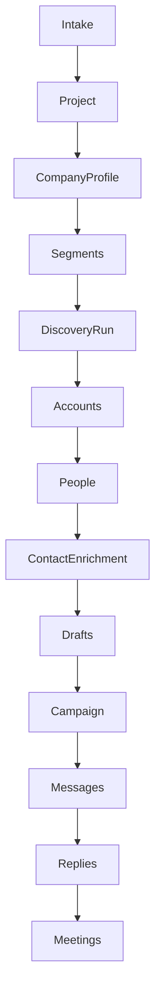
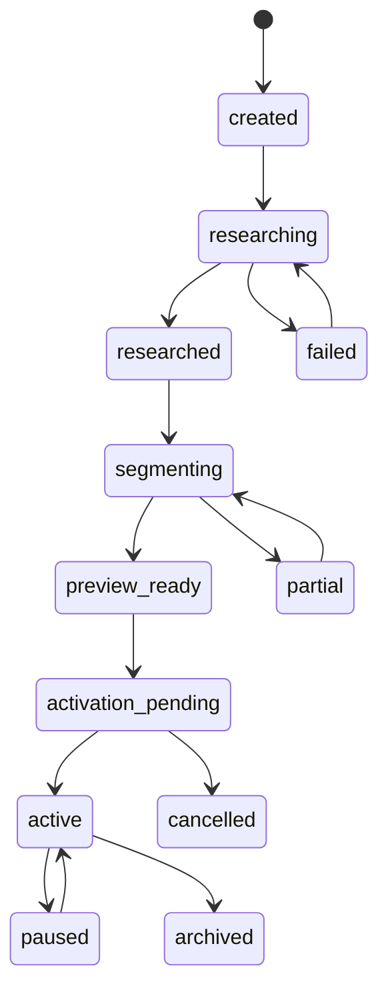

# 04 | Data model and API specification

The public browser revealed selected Explee request and response shapes. This document proposes **our own** independently named public API and internal data model. Do not call third-party private routes from production

## Data flow



## Entity inventory

| Entity | Required fields | Notes |
|---|---|---|
| `tenants` | id, name, created_at | Isolation boundary |
| `users` | id, tenant_id, auth_subject, role | Auth provider identity |
| `projects` | id, tenant_id, input_kind, input_value, status, created_at | Domain or manual brief, versioned |
| `companies` | id, canonical_domain, display_name, country, industry | External entity or prospect |
| `company_facts` | id, company_id, key, value_json, source_ref, confidence, observed_at | Provenance per fact |
| `project_company_profiles` | project_id, company_id, summary, offer_json, version | User overrides distinct from global company |
| `competitors` | id, project_id, company_id, relationship_kind, score, rationale, excluded | Market candidates |
| `segments` | id, project_id, label, buyer_type, target_geo_json, criteria_json, exclusions_json, version | Editable ICP |
| `discovery_runs` | id, segment_id, status, started_at, completed_at, query_version, idempotency_key | Stream/restart |
| `prospect_accounts` | id, run_id, company_id, fit_score, signals_json, qualification_status | Run-scoped scored company |
| `people` | id, display_name, company_id, title, profile_url, role_confidence, verified_at | Professional profile |
| `contacts` | id, person_id, email_encrypted, verification_status, source_ref, retention_until | Restricted PII |
| `enrichment_attempts` | id, person_id, vendor, status, cost, error_code, attempted_at | Audit waterfall |
| `drafts` | id, project_id, segment_id, prospect_id, subject, body, language, evidence_json, version, edited_by | Mutable with history |
| `campaigns` | id, tenant_id, project_id, segment_version, status, budget_policy_json, sender_policy_json | Activation snapshot |
| `message_jobs` | id, campaign_id, contact_id, draft_version, scheduled_at, status, dedupe_key | Idempotent send queue |
| `messages` | id, job_id, provider_message_id, sent_at, delivery_state | Delivered attempt |
| `replies` | id, message_id, received_at, intent, confidence, body_ref | Inbound conversation |
| `meetings` | id, reply_id, calendar_provider_id, starts_at, status | Confirmed booking |
| `suppression_entries` | id, tenant_id, normalized_address_hash, reason, scope, created_at | Global and account-specific DNC |
| `billing_accounts` | tenant_id, provider_customer_id, plan_mode, status | Customer billing |
| `credit_ledger` | id, tenant_id, kind, amount_minor, currency, ref_id, created_at | Immutable credits and usage |
| `authorizations` | id, tenant_id, actor_id, policy_version, terms_version, consent_at, scope_json | Send-on-behalf approval |
| `audit_events` | id, tenant_id, actor, action, object_type, object_id, before_hash, after_hash, ts | Explainability |

### Constraints

- Every tenant-scoped query must include tenant identity in authorization and database policy
- Unique `(tenant_id, canonical_domain, input_kind)` for active project dedupe where appropriate
- Unique `(run_id, company_id)` for prospect accounts
- Unique `(campaign_id, contact_id, sequence_step)` for message attempts
- Unique provider event IDs on webhooks to prevent duplicate billing, send or reply processing
- `email_encrypted` must never appear in a public preview response before access is authorized
- For public previews, use public professional profile references only where legally obtained
- Facts can conflict; store sources and timestamps instead of overwriting without provenance

## Project state machine



Discovery run states are separate: `queued`, `running`, `partial`, `completed`, `failed`, `cancelled`. Draft states: `queued`, `generated`, `edited`, `approved_by_policy`, `blocked`, `sent`. Contact states: `unknown`, `finding`, `found`, `verified`, `risky`, `not_found`, `suppressed`

## Proposed API contract

The companion `contracts/openapi.yaml` declares core endpoints. The high-level route map follows

| Method and route | Purpose | Auth |
|---|---|---|
| `POST /v1/company-search` | Search recognized companies by user input | Public, throttled |
| `POST /v1/previews` | Create/reuse project from URL or brief | Public with abuse control |
| `GET /v1/previews/{id}` | Resume and fetch safe preview | Public scoped preview token |
| `GET /v1/previews/{id}/events` | Stream phase changes and results | Preview token |
| `GET /v1/previews/{id}/segments` | Retrieve segment summary | Preview token |
| `POST /v1/previews/{id}/segments/{segmentId}/discover` | Start/reuse scoped run | Preview token, quota |
| `GET /v1/runs/{runId}/accounts` | Cursor-paginated ranked organizations | Preview token |
| `GET /v1/runs/{runId}/people` | Cursor-paginated decision makers | Preview token |
| `POST /v1/previews/{id}/drafts` | Generate draft for one approved preview person | Preview token, quota |
| `PATCH /v1/drafts/{draftId}` | Save edit and version | Auth required |
| `POST /v1/campaigns` | Create campaign from preview | Owner |
| `POST /v1/campaigns/{id}/activate` | Activate after billing and authorization | Owner |
| `POST /v1/campaigns/{id}/pause` | Stop future sends | Owner/editor |
| `GET /v1/campaigns/{id}/overview` | Operational counts and costs | Tenant member |
| `POST /v1/webhooks/billing` | Payment status and ledger entry | Verified provider signature |
| `POST /v1/webhooks/email` | Delivery and reply events | Verified provider signature |

## Preview response example

```json
{
  "id": "preview_demo_jedar",
  "status": "preview_ready",
  "input": {"kind": "domain", "value": "jedar-agency.com"},
  "company": {
    "display_name": "JEDAR",
    "domain": "jedar-agency.com",
    "country": "SA",
    "summary": "Saudi agency focused on media crisis and digital reputation services",
    "facts": [{"key": "employee_count_estimate", "value": 6, "confidence": "unverified_third_party"}]
  },
  "segments": [{"id": "segment_founder_smb", "label": "Founder-led SMBs", "estimated_accounts": 1200}],
  "phase": "draft_ready",
  "coverage": {"accounts_found": 7, "people_found": 2, "verified_emails": 0},
  "next_action": "review_then_activate"
}
```

This example is intentionally condensed and labels uncertain facts. `contracts/example-project.json` adds more fields while omitting secrets and private contact data

## Stream contract

Use Server-Sent Events for read-only preview progression and WebSocket only if an authenticated inbox truly needs bidirectional low-latency updates

Suggested event types

```text
event: phase.started
data: {"phase":"company_research","run_id":"run_demo"}

event: phase.progress
data: {"phase":"discovery","unit":"scoring_accounts","completed":24,"total":null}

event: result.partial
data: {"kind":"account","count":4,"has_more":true}

event: phase.completed
data: {"phase":"discovery","count":7}

event: run.completed
data: {"status":"completed","next":"people"}
```

Each event carries a monotonically ordered event ID and idempotent run ID. Client reconnect sends `Last-Event-ID`. Server retains a bounded event log so refreshing cannot restart expensive work or repeat content

## API error taxonomy

Use structured responses with `code`, `message`, `retryable`, `field_errors`, `request_id`, and an optional `retry_after_seconds`

| Code | HTTP | Behavior |
|---|---:|---|
| `INVALID_DOMAIN` | 422 | Inline field explanation |
| `UNSAFE_URL` | 422 | Reject localhost/private or non-web schemes |
| `AMBIGUOUS_COMPANY` | 409 | Offer choices |
| `SOURCE_UNAVAILABLE` | 503 | Use licensed data or manual brief |
| `PREVIEW_QUOTA_EXCEEDED` | 429 | Show quota and wait time |
| `RUN_IN_PROGRESS` | 202 | Return same run and stream URL |
| `NO_MATCHING_ACCOUNTS` | 200 | Empty state with segment suggestions |
| `CONTACT_UNVERIFIED` | 409 | Disable send, allow draft preview |
| `BUDGET_EXCEEDED` | 409 | Pause safely, notify owner |
| `SENDER_PAUSED` | 409 | Queue and expose reason |
| `CONSENT_REQUIRED` | 403 | Authorization gate |
| `PAYMENT_REQUIRED` | 402 | Billing state without loss of project |

## Data-quality contract

Every data field has `value`, `source`, `observed_at`, `confidence` when it materially affects a decision. Rank score includes a separate explanation and a filter decision. Estimated TAM counts should never be added together unless deduplication is performed

### Examples of quality cases observed in Jedar

- Target geography Saudi Arabia but three of seven results were outside it
- One company did not have a website/domain in the result
- People had blank geographies
- Contact lookup failed for both people, but a draft was still created
- Company profile included a 48-hour promise that should be checked against actual approved claims rather than copied automatically

## Import and export

- CSV import must map fields, preview validation, detect duplicates and verify permissible contact use
- CSV export includes selected fields and source/verification status, omits secrets
- Data deletion removes user content and PII according to policy while retaining a lawful minimal suppression hash and billing records where required
- Public preview tokens expire, are bound to safe read scopes and must not expose user or billing data
