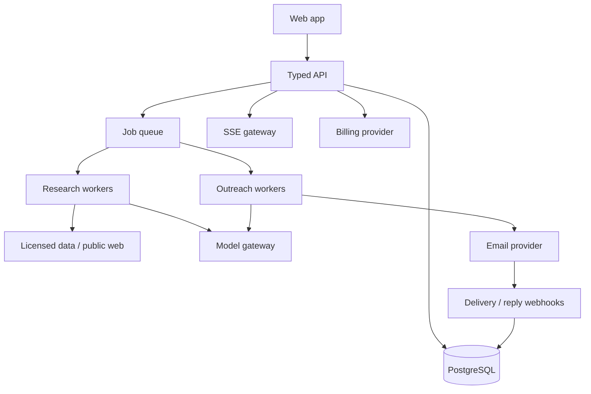

# 05 | Technical architecture and AI investigation

This is a proposed implementation blueprint, with a separate section on what could actually be established about Explee from its browser artifacts

## Observed technical footprint

| Area | Evidence | Confidence |
|---|---|---|
| Frontend | Next.js `/_next/static/chunks` and Turbopack file names | High |
| Auth | Separate `auth.explee.com` sign-in/register, Logto attribution, LinkedIn social sign-in | High |
| Billing | Stripe Elements iframe and checkout preparation endpoint | High |
| Runtime | JSON APIs and `text/event-stream` for agent progress/enrichment | High |
| Edge | Cloudflare response headers | High |
| Monitoring | Sentry trace/baggage headers | High |
| Product analytics | Plausible endpoint, `api/track` | High for client instrumentation |
| Advertising attribution | GTM/Google Ads, Meta, TikTok, LinkedIn, Bing, Reddit and OpenAI advertising pixel scripts | High for scripts loaded |
| Support | Support widget and token endpoint | High |
| Lead contact providers | Hunter, Exreacher, Findymail, LeadMagic names visible in UI | High for names, unknown for actual calls |
| LLM provider/model | No direct backend model identifier found | Unknown |

The 44 loaded Next.js public chunks were searched for `gpt-4o`, `gpt-5`, `claude-`, `gemini-`, `anthropic`, `openai`, `model_id` and relevant API paths. The `openai` occurrence was in an advertising pixel script and the `anthropic` occurrence was in a generic domain list. Neither proves an LLM supplier

The `/api/draft/generate` response disclosed an English language choice and rationale, but no `model` field. Its 216ms observed response time was not evidence of fresh inference because the run and data may have been cached or precomputed. A genuine model attribution would require a vendor disclosure, server-side telemetry, model-specific response header or a controlled authorized backend trace

## Recommended implementation stack

- **Runtime:** Bun throughout scripts, tests, package management and server execution
- **Frontend:** React with Next.js App Router or a Vite SPA plus typed API, selected once the deployment model is known
- **Language:** TypeScript in strict mode, runtime validators for every external response
- **Database:** PostgreSQL with tenant-aware policies, JSONB for evidence and versioned profiles
- **Cache and queue:** Redis-compatible queue or managed job queue; do not store sole job truth in cache
- **Object storage:** signed, expiring access to large result sets and attachments
- **Event stream:** SSE for work progress with durable event sequence
- **Auth:** managed OIDC provider, role assignment and tenant enforcement
- **Billing:** Stripe or selected licensed provider with signed webhook handling
- **Email:** licensed outbound provider plus dedicated reply ingestion and mailbox health
- **AI:** provider-agnostic model gateway, evaluators and traceable prompts
- **Observability:** structured logs, metrics, traces, run IDs and cost accounting
- **Deployment:** managed services with staged environments. No Docker or Colima required in the development workflow

## Reference architecture



## Worker and orchestration design

Each top-level work unit is a versioned, idempotent job

| Job | Inputs | Outputs | Retry policy |
|---|---|---|---|
| `resolve_company` | normalized domain / brief | company candidates and facts | retry transient source failure |
| `research_company` | company, source policy | positioning, products, evidence | bounded page/time budget |
| `find_competitors` | company profile | competitor set, rationales | cache per profile version |
| `generate_segments` | company profile and exclusions | structured segment set | schema validation, repair once |
| `find_accounts` | segment snapshot | account candidates and source links | resume by cursor |
| `score_accounts` | candidates, criteria | scores, reasons, exclusions | deterministic rerun |
| `find_people` | accounts, role brief | person candidates | provider rate-limit aware |
| `enrich_contacts` | person, vendor policy | verification result and cost | provider waterfall |
| `draft_message` | offer, prospect, evidence | draft and policy check | versioned model trace |
| `schedule_send` | verified contact, policy, draft | send job | dedupe and lock |
| `process_reply` | inbound event | intent, action, suppression | exactly-once effect by event ID |
| `book_meeting` | qualified reply, availability | provider booking ID | transactional/idempotent |
| `learn_campaign` | outcomes and eligibility | proposed tuning, rationale | batch window and rollback |

All job transitions write to the database before emitting UI events. Failed workers preserve partial valid results and explicit error state. An agent run should not restart just because the visitor changes tab or resizes the screen

## AI boundaries and recommendation

The model choice for our replica must be made with tests, not guessed from the competitor

### Model gateway input

```json
{
  "task": "draft_outbound_email",
  "prompt_version": "outbound-v1",
  "company_profile_version": 3,
  "segment_version": 2,
  "lead_evidence_ids": ["fact_001", "fact_002"],
  "locale": "en",
  "max_output_tokens": 600,
  "structured_output_schema": "OutboundDraftV1"
}
```

### Model gateway output

```json
{
  "provider": "configured_provider",
  "model": "configured_model",
  "prompt_version": "outbound-v1",
  "subject": "...",
  "body": "...",
  "claims": [{"text": "...", "source_fact_id": "fact_001"}],
  "language": "en",
  "confidence": "reviewed_by_policy",
  "token_usage": {"input": 0, "output": 0},
  "cost_minor": 0
}
```

The above is a shape illustration, not a claim about a specific provider or token usage. Use a low-cost extractor for broad structured research where its eval quality permits; use a stronger writer for critical personalization; and a narrow classifier for replies. Fallback on provider failure must not silently change facts or violate a user's language requirement

### Mandatory automated evaluations

- Grounding: every material factual claim in a personalized message traces to supplied evidence
- Language: English, Modern Standard Arabic and Saudi business Arabic remain grammatical and correctly directed
- Audience fit: account satisfies positive and negative ICP criteria
- Safety: avoids discriminatory targeting, fabricated urgency and unsupported performance claims
- Intent: interested, objection, unsubscribe, bounce and hostile reply classification
- Prompt injection: web content and recipient replies cannot alter campaign policy or tool permissions
- Cost and latency: track p50/p95 and cost per accepted output
- Human preference: concise, specific, plain spoken writing with low repetition

## Email delivery architecture

Use managed sending identities and properly configured SPF, DKIM and DMARC. Do not spoof the customer's domain or imply mail originates from the customer's account if it does not. Keep authenticated sender identity, reply-to and ownership transparent

Pipeline

1. Validate verified contact and contactability
2. Check suppression, consent basis, campaign and daily budget
3. Acquire idempotency lock for recipient plus sequence step
4. Generate/send from an eligible healthy sender
5. Record provider message ID and debit usage only by agreed billable event
6. Track delivery, bounce and reply events
7. Halt future steps on negative or unsubscribe signals
8. Trigger reply classification and booking when appropriate

Use throttling, timezone windows, duplicate suppression, bounce thresholds, domain reputation and provider complaints to pause affected senders automatically. Keep an exception queue for events needing human judgment, while ordinary follow-ups remain autonomous

## Security, privacy and authorized crawling

- SSRF controls on user-supplied URLs, DNS revalidation and blocked internal IP ranges
- No arbitrary JavaScript execution on fetched target pages; isolate extraction
- Respect robots, website access controls and rate limits; no anti-bot circumvention
- Domain verification if sending under a company identity is represented
- Tenant access checks on every API and object-store retrieval
- Encryption for contact addresses and provider credentials
- Separate marketing tracking consent from operational requirements
- Secrets in managed vault only; redact in logs and traces
- Signed and validated payment, calendar and email webhooks
- Data-source license, purpose limitation and retention policy for professional records
- Clear unsubscribe and objection handling with suppression propagation
- Auditable, versioned agent authorization and revocation

## Resilience and operations

- Define retries by error category with exponential backoff and jitter
- Use dead-letter queues with owner notifications and replay without duplicate effects
- Persist an event cursor and snapshot for every preview
- Put time/cost ceilings on search, enrichment and AI tasks
- Expose provider outages as partial coverage instead of success
- Reconcile usage ledger and provider events daily
- Use feature flags for new model versions and compare offline evaluations before rollout
- Preserve older prompt/model versions for traceability and rollback

## Why a copy of the observed backend would be fragile

The browser sees presentation API routes, not data licensing terms, source ranking, agent prompts, worker logic or private provider configuration. A replica built around those exact undocumented URLs would be brittle and outside the permitted clean-room approach. The stable approach is to reproduce the input-output behavior using independent contracts, source agreements and verifiable quality tests
