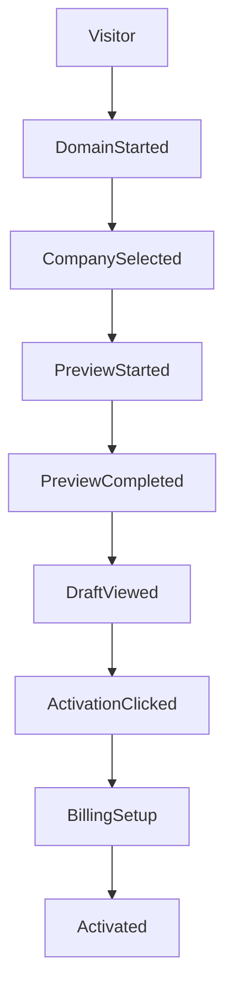

# 06 | Go-to-market funnel, product analytics and pricing

## Observed Explee acquisition funnel

The trial creates value before registration. The likely conversion mechanisms are low-effort input, a visible company match, staged progress, tangible lead rows, a real draft sample, social proof near the activation moment and a single payment handoff

## Evidence-backed conversion observations

1. Hero asks for one easy input, the website domain
2. Search suggestion includes domain, favicon, company name and a useful one-line understanding before navigation
3. Progressive stages make the operation legible and keep users waiting for a result
4. The Jedar project displayed company and person records, giving the preview a specific rather than generic feeling
5. Final tabbed workspace shows exactly what the product generated
6. Pricing claims are repeated in hero, persistent CTAs, FAQs and checkout
7. Testimonials and claimed output metrics appear at several points
8. The form redirects to authorization and card setup only after showing the preview

These observations explain the conversion design. They do not prove actual uplift, A/B test outcomes or financial success

## Pricing as observed on 9 November 2026

| Surface | Explee claim / offer | Verification status |
|---|---|---|
| Landing / FAQ | $30 free credits after card setup, roughly 750 emails | Published claim |
| Landing pricing card | $30 for 750 emails, ~2 to 6 warm leads, ~1 meeting | Forecast / marketing claim |
| FAQ | Approx. $0.04 per email, pay for sent emails in batches | Published claim |
| Paywall default | Pay $30, receive $60 credits | UI observed |
| Top-up alternatives | Pay $50 for $100, pay $100 for $200 | UI observed |
| Paywall alternate | Pay as you go, $0 charged today, then $0.04/email, card required | UI observed |
| Paywall guarantee | Refund condition if no positive replies after 1,000 emails | Published claim |
| Footer social proof | 97% inbox rate, $9 median hot lead, other benchmark numbers | Unverified claim |

**CRX issue:** landing copy implies the free credit experience, while the paywall preselects a prepaid top-up. A user may have to discover the zero-upfront alternative. Our product should show one price truth consistently and present exact due-now amount in the same visual location as the activation CTA

## Recommended pricing contract for our product

Keep units explicit

- `billable_unit`: sent outbound email or accepted qualified lead, choose one and enforce consistently
- `unit_price`: currency-denominated, versioned price
- `trial_credit`: amount, eligibility, expiry and whether card is needed
- `prepaid_bonus`: separate ledger credit from cash balance
- `due_today`: final total including tax, before payment action
- `daily_cap`: hard spending limit with pause when reached
- `forecast`: clearly estimated, using a visible assumption range
- `refund_policy`: readable conditions and exact qualifying events
- `cancel`: immediate pause of unsent jobs and clear handling of remaining credit

Do not count email composition, lead enrichment or failed sends as billable email unless expressly agreed and clearly disclosed

## North-star metric

**Qualified positive conversations per active customer per month**, accompanied by cost and customer-reported quality. Do not substitute opens or a raw reply count for pipeline value

## Funnel metrics

| Metric | Numerator / denominator | Why |
|---|---|---|
| Domain start rate | domain focus or input / landing visitors | Hero intent |
| Company-match rate | recognized companies / valid domains | Dataset coverage |
| Preview start rate | previews begun / valid inputs | Search to trial conversion |
| Preview completion rate | previews with terminal state / previews begun | Agent reliability |
| Time to first meaningful result | first segment or account rendered minus preview start | Perceived speed |
| Draft-view rate | draft viewed / previews completed | Value realization |
| Activation intent | activation CTA / draft views | Purchase intent |
| Checkout completion | successful billing setups / checkout starts | Payment friction |
| First-send activation | campaigns with a delivered first email / activated campaigns | Core success |
| Positive reply rate | positive human replies / delivered emails | Targeting and copy quality |
| Qualified conversation rate | qualified conversations / delivered emails | Lead quality |
| Meeting booking rate | booked meetings / positive conversations | Conversion |
| Effective cost per qualified lead | total spend / qualified positive conversations | Economics |
| Unsubscribe/complaint rate | unsubscribes or complaints / delivered | Deliverability and consent |

## Event dictionary for implementation

Common fields for all events: `event_id`, `anonymous_or_user_id`, `tenant_id_if_any`, `session_id`, `project_id`, `experiment_variant`, `device_type`, `locale`, `occurred_at`, `consent_state`. Never include raw addresses, credit-card details or full email bodies in analytics

| Event | Additional fields | Trigger |
|---|---|---|
| `landing_view` | entry_source, campaign_utm | First meaningful view |
| `domain_search_started` | input_length, source_type | Debounced search starts |
| `domain_suggestion_returned` | count, latency_ms | Suggestions rendered |
| `company_selected` | match_type, confidence_bucket | Exact candidate chosen |
| `manual_brief_opened` | origin | No-website CTA |
| `preview_started` | input_kind, run_origin | Project accepted |
| `phase_started` | phase_name, run_id | Server job starts |
| `phase_completed` | phase_name, duration_ms, count, partial | Server terminal event |
| `phase_failed` | phase_name, error_code, retryable | Failure visible |
| `segment_detail_viewed` | segment_id, estimated_size_bucket | Detail open |
| `result_tab_changed` | from_tab, to_tab | Tab switch |
| `draft_rendered` | language, verified_email_exists, source_count | Draft displayed |
| `draft_modified` | subject_changed, body_changed | User edit, no content logged |
| `billing_modal_opened` | source_cta, default_plan | Activation handoff |
| `billing_plan_selected` | plan_mode, due_today_minor | Radio/tier selection |
| `send_authorization_checked` | policy_version | Checkbox changes |
| `billing_completed` | plan_mode, amount_minor, currency | Verified provider webhook |
| `campaign_activated` | campaign_id, daily_cap_minor | Backend activation success |
| `email_sent` | sequence_step, sender_pool, cost_minor | Provider accepted send |
| `email_delivered` | delivery_latency_ms | Provider delivery event |
| `positive_reply` | intent, classifier_version | Intent verified/classified |
| `meeting_booked` | booking_provider, lead_id | Confirmed meeting |
| `campaign_paused` | reason, actor_type | Stop state confirmed |

## Data-quality metrics

- Company match precision by market and language
- Segment relevance measured by owner feedback
- Hard-filter violation rate by geography and exclusion
- Contact verification yield and bounce rate by provider
- Person-role recency and employment confidence
- Source evidence coverage per personalized claim
- Draft factuality and language correctness
- Cost and latency per task/model/provider
- Duplicate prospect/send prevention rate
- Suppression enforcement and unsubscribe time

## Experiment backlog

| Hypothesis | Variants | Primary outcome | Guardrail |
|---|---|---|---|
| Visitors need payment clarity | Free-credit explanation beside CTA vs only in FAQ | Checkout completion | Charge disputes |
| Value preview helps activation | Show two real leads before draft vs draft-first | Activation intent | Preview load time |
| Lead reasoning builds trust | Fit rationale visible vs collapsed | Segment review / activation | UI clutter |
| Arabic customers need language control | Explicit Arabic/English choice vs auto | Draft acceptance | Editing time |
| Honest coverage is better | Show verified-contact count before activation vs not | First-send conversion | Early bounce |

No test should make misleading guarantees or hide material billing terms

## Attribution boundaries

The browser loaded Google Tag Manager, Google Ads, TikTok, Meta, Reddit, LinkedIn, Bing and an OpenAI advertising pixel, with Plausible and in-house tracking calls. This demonstrates active frontend marketing instrumentation, but not the complete attribution logic, event mapping, server-side CAPI configuration or ROAS. Our implementation needs a privacy-respecting event schema and separate vendor adapter layer, configured only for consented marketing use
