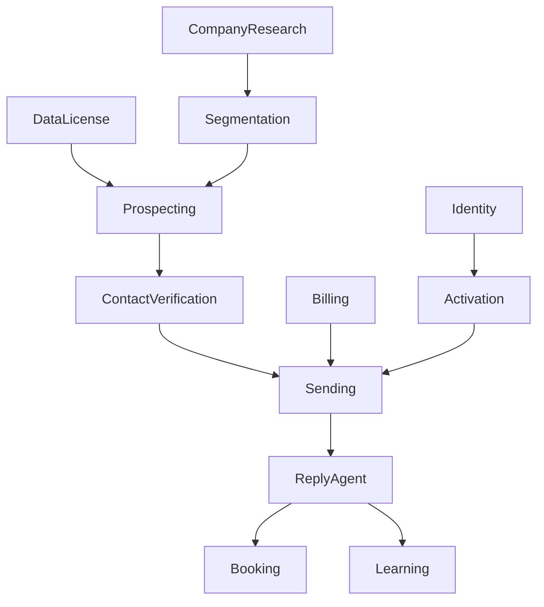

# 10 | Implementation plan and dependency map

This is a sequence of delivery slices, not a calendar promise. The scope of a production email agent depends on data licensing, deliverability provider and billing decisions

## Release strategy

| Slice | Product result | Exit conditions |
|---|---|---|
| R0 Foundation | Repository, type contracts, auth boundary, tenant data model, design foundations | Tests/build/CI work, architecture decision recorded |
| R1 Public preview | URL search, no-website intake, company profile, progress and resumable project | Anonymous end-to-end test passes |
| R2 Market and ICP | Competitors, six-segment-style generation, editable criteria and rationales | Structured output and data-quality tests |
| R3 Prospect research | Discovery workers, account scoring, people lookup, streaming tables | Geo hard filters, retries and partial state verified |
| R4 Personalized drafts | Evidence-grounded message builder, language, tone, editor, versioning | Draft factuality, Arabic, persistence and no-email send gate |
| R5 Activation and sending | Billing, consent, sender infrastructure, contact verification, schedules | Sandbox send, usage ledger and suppression suites pass |
| R6 Autonomous replies/booking | Reply classifier, follow-up policy, booking, exception queue | Full simulated conversation to meeting succeeds |
| R7 Learning and analytics | Cohorts, costs, experiments, guarded adjustments, audit history | Stable pilot metrics and rollback |

## Dependencies

## Work packages

### WP-01. Repository and quality baseline

- Bun-based scripts and package manager, TypeScript strict mode
- Unit, integration and Playwright suites in CI
- Lint, formatting, secret scan, dependency scan and accessibility checks
- Environment templates with safe defaults and no live credentials
- Staging/test configuration and feature flags

### WP-02. Design and frontend

- Original brand tokens and typography with Arabic support
- Landing, company search, manual brief, six-stage preview
- Desktop split pane and mobile accordion
- Companies, People, Emails views, modal and drawer behavior
- Loading, partial, empty, error, retry, cached and activated states
- Keyboard and focus management, mobile safe area and responsive tables

### WP-03. Research and scoring

- Licensed data provider selection and schema adapters
- Company profile facts with sources and overrides
- Competitor candidates and reasons
- ICP segment JSON schema and validation
- Deterministic geo/exclusion hard filters
- Scoring explainability and duplicate handling

### WP-04. Agent execution

- Durable queue and run state machine
- SSE event log and resume cursor
- Quotas and cost counters per project
- One worker per major stage with replay and cancellation
- Provider failure mapping, partial run semantics

### WP-05. Drafts and language

- Structured model gateway and prompt-version registry
- Draft generation, factuality validator and language rationale
- Arabic and English controlled editor
- Draft version history, autosave and regeneration
- Contact availability and policy send gate

### WP-06. Commercial activation

- Registration, tenant ownership and permissions
- Billing products, credit ledger, due-now UI and spend caps
- Explicit sending authorization with recorded terms
- Sender provisioning, domain identity, health checks and schedule
- Sandbox payment/send workflows first

### WP-07. Inbox, bookings and learning

- Inbound event receiver and normalized conversation timeline
- Reply intent classifier, objection handling and suppression
- Booking/calendar integration and time-zone handling
- Experiment tracking and model evaluation
- Guarded automatic adjustments, audit trail and rollback

## Scope guardrails

**Do not** implement undocumented Explee API calls as app dependencies, copy frontend bundles, copy visuals/testimonials, harvest unlicensed contact databases, spoof company senders, or put real emails into demo fixtures

**Do** test the observed user outcome: the visitor enters their website, sees accurate market understanding and qualified prospects, edits an honest draft and can authorize automatic follow-up with measurable limits

## Release artifacts

For each slice deliver

1. Source and migration changes in atomic commits
2. API/schema change log
3. Automated test results and E2E trace
4. Desktop/mobile accessibility evidence
5. Updated known gaps and rollback plan
6. Product demo with synthetic data
7. A short note separating live functionality from mocked or planned behavior

## Unresolved decisions

- Data sources and geographic coverage
- Which sender/provider and who owns sender domains
- Whether a free preview has caps by IP, session or verified email
- The legal/consent framework for each target market
- Billing mode and exact paid unit
- Calendar providers and booking behavior
- Workspace roles and CRM connectors
- AI model(s), budget/latency envelope and acceptable content criteria

These are product owner decisions, not blockers to implementing a synthetic preview prototype
