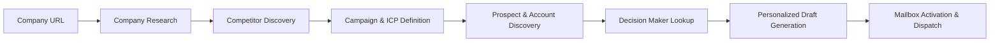

# Explee Auto-GTM Reconstruction Specifications

Comprehensive, clean-room technical architecture, reverse-engineering analysis, and reconstruction specifications for an autonomous Go-To-Market (Auto-GTM) prospecting and outreach engine.

> [!NOTE]
> Designed from observed low-friction onboarding patterns (URL input to company research, competitor mapping, ICP segmentation, decision-maker discovery, personalized outreach drafts, and mailbox activation).

---

## 📑 Specification Index

| Document | Focus Area | Description |
|---|---|---|
| [00_README_AR.md](00_README_AR.md) | Executive Summary (العربية) | ملخص تنفيذي بالعربية لنطاق الفحص وأهم النتائج وحدود البحث |
| [01_OBSERVED_JOURNEY.md](01_OBSERVED_JOURNEY.md) | User Journey | Step-by-step user onboarding & preview funnel analysis |
| [02_UI_UX_CRX_SPEC.md](02_UI_UX_CRX_SPEC.md) | Interface & UX | Layout, state machines, component architecture, and interaction models |
| [03_GTM_FUNCTIONAL_SPEC.md](03_GTM_FUNCTIONAL_SPEC.md) | GTM Logic | Six core preview phases & post-activation operational pipeline |
| [04_DATA_AND_API_SPEC.md](04_DATA_AND_API_SPEC.md) | Data Contracts | Database entities, relational schema, and REST/streaming API endpoints |
| [05_TECH_ARCHITECTURE.md](05_TECH_ARCHITECTURE.md) | Systems Architecture | Multi-agent coordination, asynchronous workers, and security boundaries |
| [06_ANALYTICS_AND_PRICING.md](06_ANALYTICS_AND_PRICING.md) | Business Logic | Credit system, unit economics, analytics events, and conversion funnel |
| [07_CRX_AUDIT.md](07_CRX_AUDIT.md) | Design & Accessibility | Design tokens, color contrast, typography, and accessibility audits |
| [08_QA_ACCEPTANCE.md](08_QA_ACCEPTANCE.md) | Verification | Acceptance test suites, edge cases, and compliance matrices |
| [09_EVIDENCE_LEDGER.md](09_EVIDENCE_LEDGER.md) | Evidence Ledger | Strict categorization of observed facts vs. architectural inferences |
| [10_IMPLEMENTATION_PLAN.md](10_IMPLEMENTATION_PLAN.md) | Delivery Roadmap | Phased release strategy (R0 to R7) and dependency map |
| [11_BUILD_AGENT_PROMPT.md](11_BUILD_AGENT_PROMPT.md) | Build Agent System Prompt | Operational prompt for autonomous implementation agents |
| [contracts/openapi.yaml](contracts/openapi.yaml) | API Specification | OpenAPI 3.1 contract definition |
| [contracts/example-project.json](contracts/example-project.json) | Data Schema Sample | Representative pipeline state snapshot |

---

## 🏗️ Architecture Overview

## ⚖️ Clean-Room Principles

All specifications within this repository have been developed strictly under clean-room engineering principles:
- Grounded purely in black-box external observations and public web surface analysis.
- Zero proprietary code, assets, or trademarks replicated.
- Functional requirements abstracted into open, vendor-neutral specifications.
